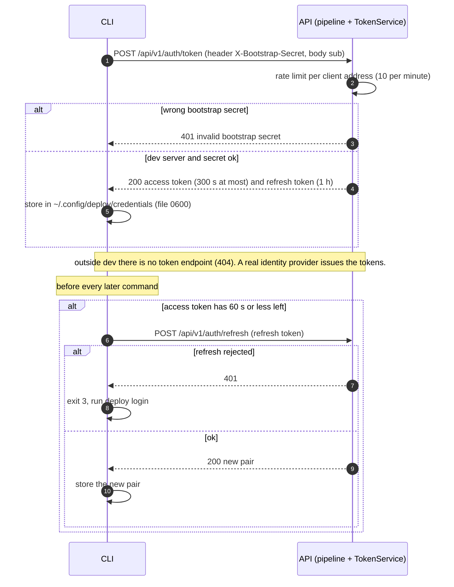
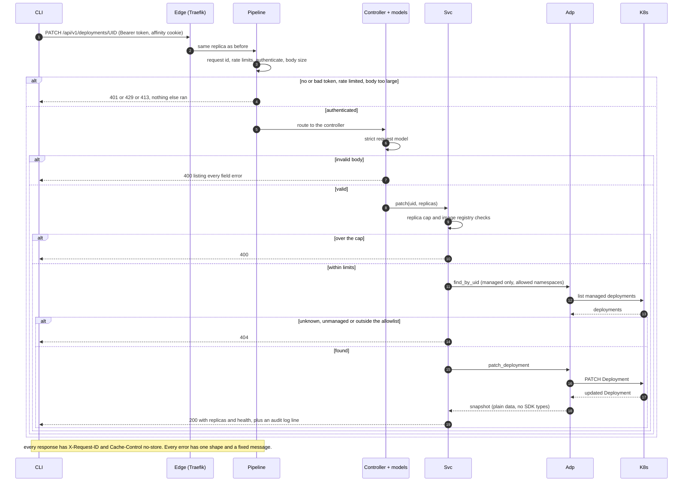
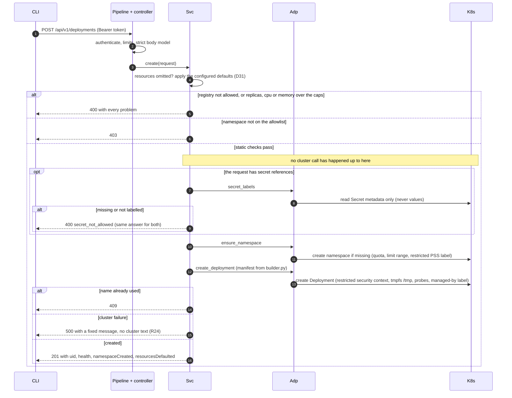
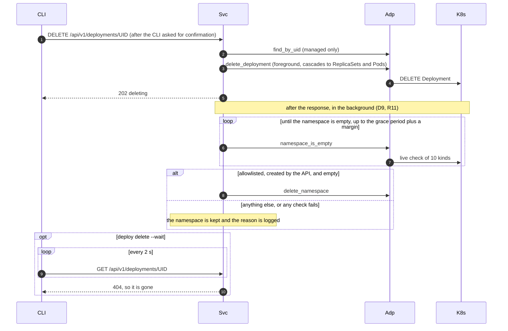
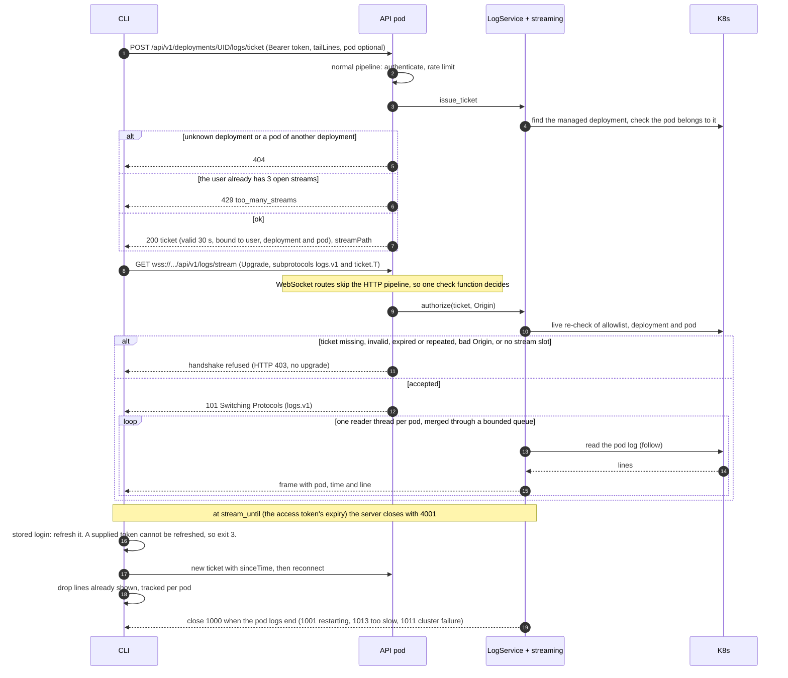

# Sequence diagrams

The main flows between the `deploy` CLI, the API and Kubernetes, as built. The diagrams are Mermaid, which GitHub renders
in place. The static picture of the components is in [`architecture.md`](./architecture.md). Rule IDs (A1, V14, LG7 ...) and
decisions (D9, D28 ...) point into [`../spec/req.md`](../spec/req.md).

Cast: **CLI** (`control-plane/cli`), **Edge** (Traefik, sticky cookie), **Pipeline** (the HTTP middleware in `security.py`),
**Svc** (`DeploymentService` / `LogService`), **Adp** (`ClusterPort` implemented by `KubernetesAdapter`), **K8s** (the
Kubernetes API server).

## 1. Login and token refresh

Rules: R1, R4, T1–T6 (`req-auth.md`, `req-security.md`), CL9–CL13 (`req-cli.md`).

## 2. An ordinary command: `deploy scale <id> --replicas 3`

Rules: A1–A4, V1–V25, D1, D2, D21, N1–N7, R24. A caller without a valid token only ever sees 401, so a bad body or an
unknown id cannot be probed.

## 3. Create: the order of the checks

Rules: D2, D4, D8, D9, D11, D21, D31, R6–R14, R19, K7–K10.

## 4. Delete, and the namespace cleanup afterwards

Rules: D9, R11, CL27–CL29.

## 5. Log streaming (D28): authenticate over HTTP, then switch to WebSocket

Rules: D28, D29, D30, LG1–LG19 (`req-logs.md`), R21, T8, CL30–CL34.

## 6. Errors, one shape

Whatever fails, the client gets `{"error": {"code", "message", "request_id", "details"?}}`. Kubernetes failures are
reduced to a kind in the adapter and to a fixed message in the service:

| Cluster result | Kind | HTTP | Message |
| :--- | :--- | :--- | :--- |
| 404 | `not_found` | 404 | deployment not found |
| 409 | `conflict` | 409 | name already in use |
| 401 or 403 from the cluster | `forbidden` | 500 | operation not permitted by the cluster |
| network error or timeout | `unreachable` | 500 | cluster unreachable |
| anything else | `other` | 500 | cluster operation failed |

The CLI shows the message, one line per detail, and the request id, and never raw JSON (CL4, CL5).
