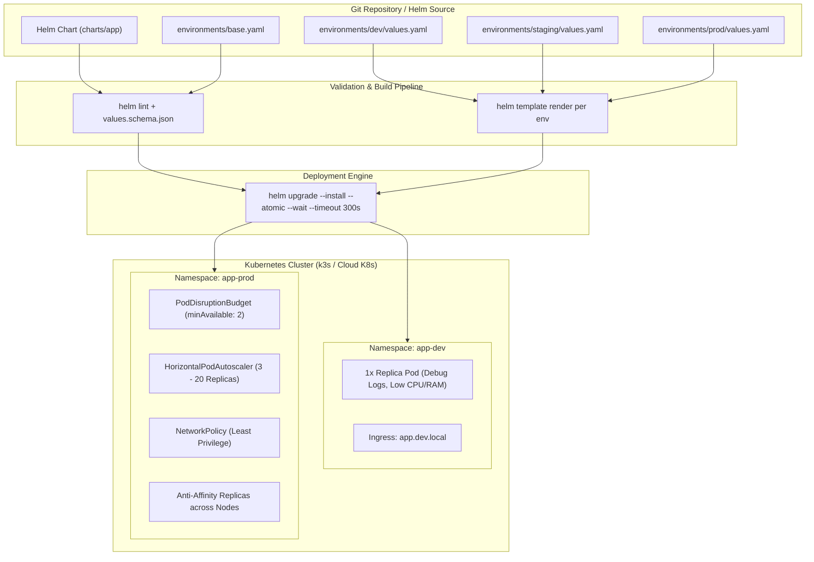
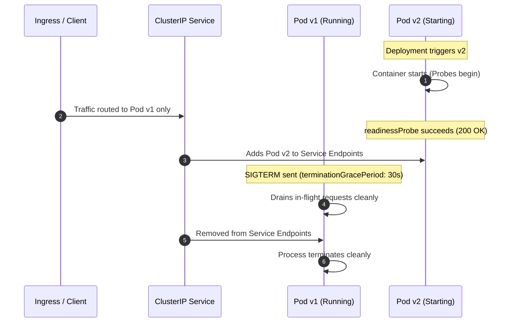
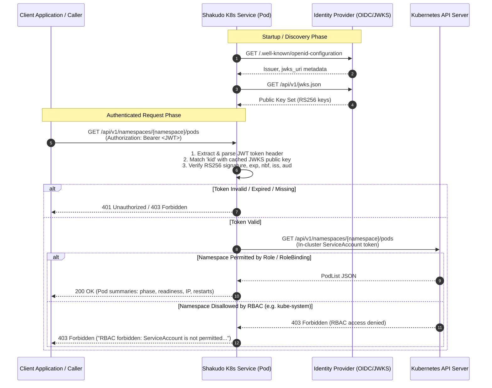

# System Architecture & Design Specification

This document details the architectural layout, configuration hierarchy, security postures, and lifecycle management patterns governing the Kubernetes deployment framework.

---

## 1. High-Level Architecture Diagram



---

## 2. Configuration Hierarchy (Eliminating Drift)

Configuration drift between staging and production is one of the highest causes of outages in platform engineering. This repository utilizes a strict four-layer precedence model:

```text
Layer 1: Canonical Chart Defaults (charts/app/values.yaml)
   └── Validated strictly by JSONSchema (charts/app/values.schema.json)
        ▼
Layer 2: Platform Baseline (environments/base.yaml)
   └── Enforces corporate security contexts, logging drivers, and metadata
        ▼
Layer 3: Environment Overrides (environments/{dev,staging,prod}/values.yaml)
   └── Sizing, scaling targets, ingress DNS, and replica topologies
        ▼
Layer 4: Runtime Secrets (External Secrets Operator / Vault / SOPS)
   └── Decrypted dynamically into Kubernetes Secrets
```

### Inheritance Example
If a value is not specified in `environments/dev/values.yaml`, it automatically falls back to `environments/base.yaml`, and finally to `charts/app/values.yaml`. Developers only define deltas in their environment overlays.

---

## 3. Workload Hardening & Security Model

Workloads comply with the **Pod Security Standard (PSS) restricted profile**:

```yaml
spec:
  securityContext:
    runAsNonRoot: true
    runAsUser: 101
    runAsGroup: 101
    fsGroup: 101
    seccompProfile:
      type: RuntimeDefault
  containers:
    - name: app
      securityContext:
        allowPrivilegeEscalation: false
        readOnlyRootFilesystem: true
        capabilities:
          drop: ["ALL"]
```

### Writeable Scratch Space
Because `readOnlyRootFilesystem: true` blocks attackers from writing binaries or malicious scripts to disk, ephemeral writable directories (`/tmp`, `/var/cache`, `/var/run`) are mounted via `emptyDir` in-memory tmpfs volumes.

### Least-Privilege Identity
The associated `ServiceAccount` specifies `automountServiceAccountToken: false`. Pods cannot read the cluster API server credentials unless an explicit Kubernetes operator integration is declared.

---

## 4. Zero-Downtime Rollout Strategy



### ConfigMap & Secret Checksum Automation
To prevent "stale configuration" bugs where a ConfigMap is updated but running pods continue using old in-memory settings, our `Deployment` computes SHA256 checksums:

```yaml
annotations:
  checksum/config: {{ include (print $.Template.BasePath "/configmap.yaml") . | sha256sum }}
  checksum/secret: {{ include (print $.Template.BasePath "/secret.yaml") . | sha256sum }}
```

Updating any configuration key triggers Kubernetes to automatically initiate an orchestrated rolling replacement of all replica pods without downtime.

---

## 5. Failure Domains & Blast Radius Mitigation

| Mechanism | Purpose | Dev | Staging | Prod |
| :--- | :--- | :---: | :---: | :---: |
| **PodDisruptionBudget (PDB)** | Guarantees minimum available pods during node drains or upgrades | Disabled | `minAvailable: 1` | `minAvailable: 2` |
| **HorizontalPodAutoscaler (HPA)** | Autoscales pods based on CPU/RAM utilization | Disabled | 2 - 5 pods | 3 - 20 pods |
| **Pod Anti-Affinity** | Distributes pods across distinct physical compute nodes | Disabled | Optional | Preferred host anti-affinity |
| **NetworkPolicy** | Drops unauthorized ingress/egress east-west traffic | Disabled | Enabled | Enabled (Strict) |

---

## 6. OIDC Discovery, JWT Validation & Kubernetes RBAC Integration



### Key Security & Design Invariants:
1. **Cryptographic Validation**: JWTs are strictly validated using RS256 asymmetric cryptography. Signatures, expiration (`exp`), not-before (`nbf`), issuer (`iss`), and audience (`aud`) are enforced on every request.
2. **Least Privilege RBAC**: The workload `ServiceAccount` is bounded strictly by a namespace-scoped `Role` and `RoleBinding` granting read-only verbs (`get`, `list`, `watch`) on `pods` and `pods/status`.
3. **Defense-in-Depth**: Requests querying namespaces beyond the bound scope are blocked at the Kubernetes API layer, returning an explicit 403 error without crashing or leaking sensitive cluster metadata.
4. **Resilient Client Initialization**: The service attempts `load_incluster_config()` when running in Kubernetes pods, falling back to local `load_kube_config()` for developer testing.
